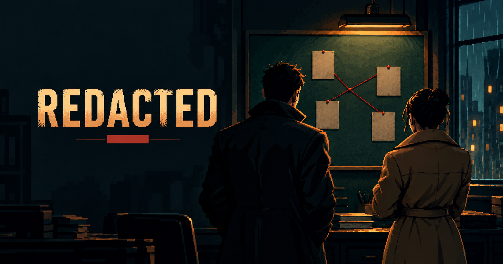

# Redacted



**A pixel-noir detective game for one or two players, in the browser.** Every case is a murder in a generated city. You travel the streets, search rooms, review camera logs, run lab tests, read phones and records, and question suspects who lie to protect themselves. When you're sure, you write up your report and the case is scored out of five stars.

The game never solves anything for you: there are no hints, suspicion meters or auto-filled clues. Everything you find is real stored evidence. Working out what it means is your job.

## How a case plays

1. **Read the brief.** You get the victim, where and when they were found, who reported it, and the victim's home and workplace.
2. **Investigate the city.** Drive between at least 10 places and walk through buildings room by room. Hold to search furniture and pick up what you find.
3. **Use the bureau and the lab.** Search public records, review CCTV logs (text only, no footage), examine phones and laptops, and run forensic tests on bagged evidence.
4. **Interview people.** Call anyone you've come across into the bureau and question them freely. Each person plays their own part live. They don't know the solution, and they lie until you show them proof that catches them out.
5. **Build your theory.** Everything you uncover lands in a shared notebook. Pin people and evidence to the clueboard and tie strings between them.
6. **File the report.** Name the killer and explain the motive, weapon, method and evidence. You get one star for each one you get right, then see what really happened.

Every action takes game minutes on a shared clock, and each case has a deadline. Two detectives can split up and work at the same time.

## Playing together

- **1–2 players per case.** Share an invite link or the 6-letter room code, or play alone.
- **Partners share everything:** the clock, inventory, notebook, clueboard, notes and every interview.
- **Replay any finished case** in a fresh room, or pick from the archive and the case of the day.
- **Case history** keeps your results, stars, rank and badges.

## How cases are made

Cases are **generated once, checked, then frozen.** An AI pipeline writes the crime, cast, story and lies. Code builds the city, timeline and evidence, and checks the case can be solved before it's published. Building interiors come from templates and a seed, not AI.

During play, AI is only used for the people you interview and for grading your final report. It never creates new evidence.

## Built with

Next.js on Vercel, Convex (database, backend functions and realtime), Clerk (sign-in), React Flow (clueboard), the Vercel AI SDK with the Convex Agent component (interviews), and Sentry (errors and player reports).

## Docs

Start with [AGENTS.md](./AGENTS.md), which links every design doc: architecture, database, game systems, generation, security and decisions. Shipped work is logged in [docs/progress.md](./docs/progress.md), and the to-do list is [docs/ROADMAP.md](./docs/ROADMAP.md).

## Development

```bash
npm install
npm run dev
```

Copy `.env.example` to `.env.local` and set `NEXT_PUBLIC_CONVEX_URL` for Convex-backed local development.

## Case generation

Cases are generated once by an AI pipeline on Convex (`convex/generation/`): code builds the city, timeline, evidence and checks; AI writes the crime, cast, story, lies, text and brief. Each AI stage tries an ordered list of models (`STAGE_MODELS` in `convex/generation/llm.ts`) and skips providers with no key. Full design: [docs/GENERATION.md](./docs/GENERATION.md).

**Models.** Set the keys you use in the Convex environment (`npx convex env set NAME value`): `CODEX_API_KEY` + `CODEX_BASE_URL` (GPT-6 Sol, first choice), `MOONSHOT_API_KEY` (Kimi, paid fallback), `GROQ_API_KEY` (text and brief), and optionally `GEMINI_API_KEY`, `OPENROUTER_API_KEY`, `NIM_API_KEY` as free backups.

**GPT-6 Sol through the local Codex server.** Convex runs in the cloud, so it reaches the server on your PC through a Cloudflare quick tunnel, protected by a password:

```powershell
# 1. The server, with the password from .env.local (CODEX_API_KEY); it stays on 127.0.0.1.
$k = (Select-String -Path .env.local -Pattern '^CODEX_API_KEY=(.*)').Matches[0].Groups[1].Value
uvx openai-api-server-via-codex --api-key $k

# 2. The tunnel (in a second window); it prints an https://….trycloudflare.com address.
& "C:\Program Files (x86)\cloudflared\cloudflared.exe" tunnel --url http://127.0.0.1:18080

# 3. Point Convex at it (again after every tunnel restart: the address changes).
npx convex env set CODEX_API_KEY $k
npx convex env set CODEX_BASE_URL https://<address>.trycloudflare.com/v1
```

Both stop when the PC restarts. While they are down, every stage falls back to Kimi. To stop using Sol, remove `CODEX_API_KEY` from the Convex env.

**Trying it.** The dev-only tester at `/dev/generation` (for users listed in `DEV_TOOL_USER_IDS`) runs one stage or a whole case, a 3-case test run, and per-stage stats. Tests: `npx vitest run`.

